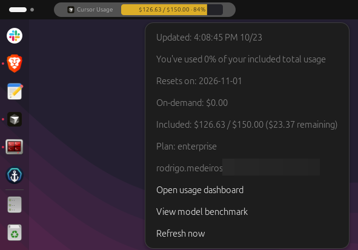

# gnome-cursor-usage

**Cursor** usage and credit on the **GNOME** top bar: icon, `$ used / limit`, percentage, and a menu with plan details. Uses your logged-in Cursor desktop session and the same data as the [usage dashboard](https://cursor.com/dashboard/usage).

Unofficial tool — not affiliated with Cursor or Anysphere.



## How it works

A **Python daemon** (autostart) reads your session, calls Cursor’s usage API, and writes a cache file. The **GNOME extension** only reads that file and draws the panel — Shell does not call the API on its own.

```text
  state.vscdb ──► daemon ──► cursor.com
                    │
                    ▼
               status.json  ◄── extension (top bar)
```

The daemon refreshes the cache every **5 minutes** by default; the extension re-reads it every **30 seconds**. **Refresh now** in the menu runs an immediate fetch and updates the bar as soon as it finishes.

**Requirements:** GNOME Shell 45+, Cursor logged in, Python 3.10+ (stdlib only).

## Install

```bash
cd /path/to/gnome-cursor-usage
chmod +x install.sh bin/gnome-cursor-usage
./install.sh
```

`install.sh` installs the **Cursor Usage** extension (`gnome-cursor-usage@local`), enables daemon autostart, and records the repo path for the extension. If the bar does not appear, reload GNOME Shell: **Alt+F2** → `r`.

## Uninstall

```bash
gnome-extensions disable gnome-cursor-usage@local
rm -rf ~/.local/share/gnome-shell/extensions/gnome-cursor-usage@local
rm -f ~/.config/autostart/gnome-cursor-usage-daemon.desktop
pkill -f 'gnome-cursor-usage --daemon' || true
```

Reload Shell: **Alt+F2** → `r`. Optional cleanup: `~/.config/gnome-cursor-usage` and `~/.cache/gnome-cursor-usage`.
